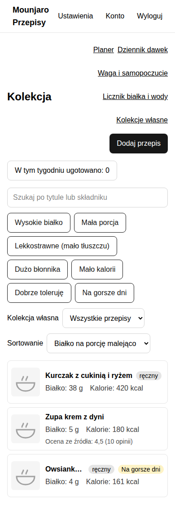

# Mounjaro Przepisy

Prywatna aplikacja na telefon dla osoby na diecie wspieranej lekiem Mounjaro.
Odpowiada na jedno pytanie: **co dziś ugotować, żeby było smaczne, białkowe i
żebym to dobrze zniósł?**

Zbierasz w niej sprawdzone przepisy, filtrujesz je pod swoją dietę i gotujesz
krok po kroku, także bez internetu. Aplikacja nie wymyśla przepisów i nie
wylicza dawek leku: smak przepisów z AI jest nie do sprawdzenia, a dawkę ustala
lekarz.

Jest przeznaczona dla jednej osoby. Zalogować się może tylko konto Google
podane przy instalacji; nie ma rejestracji ani udostępniania. Interfejs jest po
polsku.



## Co umie

- **Kolekcja przepisów:** własne przepisy i dodawane z linku do serwisu kulinarnego, z oceną i historią ugotowań.
- **Filtry pod Mounjaro:** wartości odżywcze i wybór dań, które dobrze się znosi.
- **Wyszukiwanie** przepisów w zaufanych serwisach.
- **Tryb gotowania:** składniki i kroki na jednym ekranie, działa bez internetu.
- **Planer tygodnia i lista zakupów.**
- **Dziennik dawek** z podpowiedzią, w które miejsce zrobić kolejny zastrzyk.
- **Przypomnienie o zastrzyku** jako powiadomienie na telefonie.
- **Twoje dane:** eksport wszystkiego do pliku ZIP i usunięcie konta jednym ruchem.

## Czego potrzebujesz

- [ ] serwer z Linuksem z zainstalowanym Dockerem (Compose 2.24 lub nowszy),
- [ ] własna domena skierowana na adres serwera,
- [ ] konto Google, którym będziesz się logować,
- [ ] klient OAuth w Google: instrukcja krok po kroku w [docs/operations.md](docs/operations.md#klient-oauth-w-google),
- [ ] zaszyfrowany dysk serwera, bo aplikacja przechowuje dane o zdrowiu.

## Wdrożenie

Zalecana ścieżka to instalator. Na serwerze, w katalogu pobranego repozytorium:

```bash
scripts/install.sh
```

Instalator sprawdza wymagania, przygotowuje ustawienia i hasła, pyta tylko o to,
czego nie da się wygenerować (domena, konto Google, dane klienta OAuth),
uruchamia aplikację i czeka, aż zacznie działać. Można go uruchomić ponownie:
pomija to, co już zrobione.

Do wyboru są dwa sposoby obsługi HTTPS: wbudowany **caddy** sam załatwia
certyfikat, a **proxy** wybierasz, gdy serwer ma już własny serwer pośredniczący.

Wolisz zrobić to ręcznie albo potrzebujesz trybu bez pytań? Zobacz
[instalację ręczną](docs/operations.md#instalacja-ręczna-alternatywa).

## Pierwsze kroki

1. Otwórz w przeglądarce telefonu adres swojej domeny.
2. Zaloguj się kontem Google podanym przy instalacji.
3. Dodaj aplikację do ekranu głównego: w Chrome menu → „Zainstaluj aplikację”, w Safari przycisk udostępniania → „Dodaj do ekranu początkowego”.
4. Dodaj pierwszy przepis, wklejając link albo wpisując go ręcznie.

## Aktualizacja

Na serwerze pobierz nową wersję (`git pull`) i uruchom ponownie
`scripts/install.sh`. Twoje dane zostają.

## Dane i prywatność

Twoje dane to dane o zdrowiu i są traktowane odpowiednio: nie trafiają do logów
ani zewnętrznych usług, a aplikacja nie ładuje analityki ani zewnętrznych
skryptów.

- Wszystko jest na Twoim serwerze.
- Co 6 godzin powstaje zaszyfrowana kopia bazy; klucz do jej odczytania trzymasz Ty, poza serwerem (szczegóły: [kopie zapasowe](docs/operations.md#kopie-zapasowe)).
- Eksport danych i usunięcie konta zrobisz sam: Ustawienia → „Moje dane”. Po usunięciu konta dane znikają także z kopii w ciągu 30 dni.

## Dla programistów

Układ kodu, komendy, uruchomienie lokalne i proces pracy: [docs/development.md](docs/development.md).
